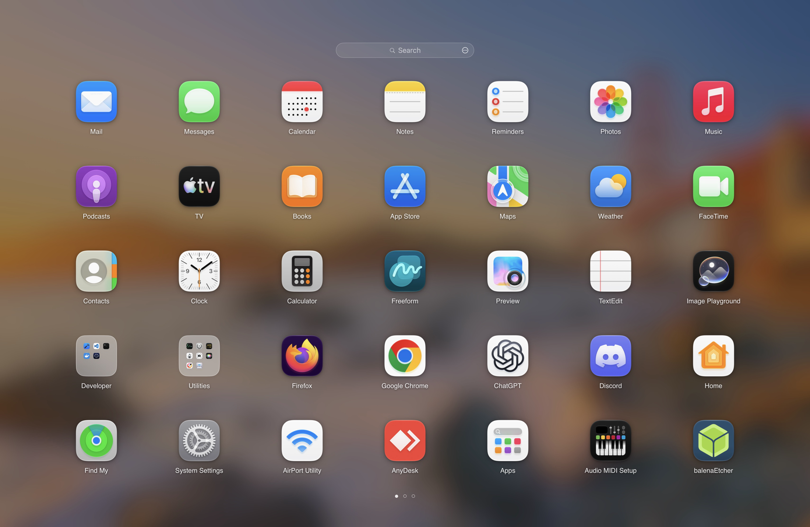
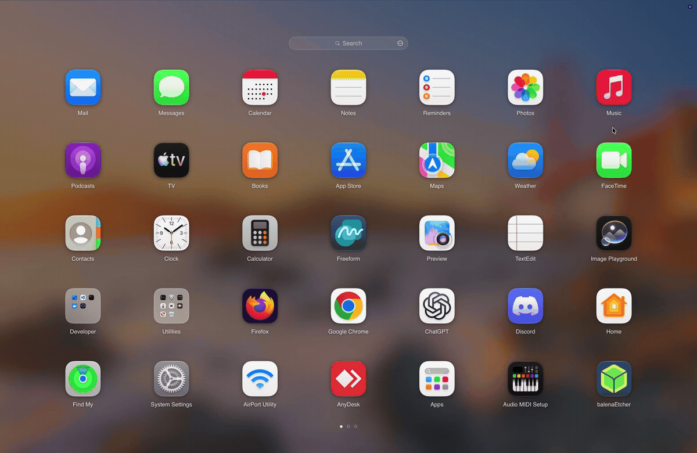
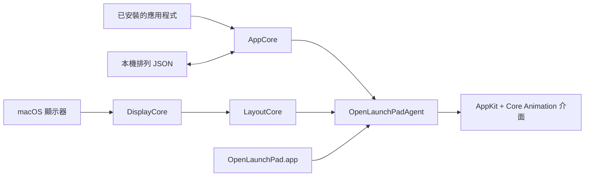

# OpenLaunchPad

[English](README.md) · [繁體中文](README.zh-TW.md)

**為現代 macOS 打造，快速、原生的 Launchpad 風格應用程式啟動器。**

目前版本：**OpenLaunchPad 1.0（build 1）**。

OpenLaunchPad 為 Apple silicon Mac 帶來熟悉的全螢幕應用程式網格，支援即時搜尋、資料夾、拖放整理與流暢翻頁。專案開源，以本機運作為優先，使用 Swift、AppKit 與 Core Animation 開發。

<p align="center">
  <a href="https://github.com/LuckyFishOno/OpenLaunchPad/releases/latest"></a>
  
  
  
  <a href="LICENSE"></a>
</p>

<p align="center">
  
</p>

<p align="center">
  <a href="https://github.com/LuckyFishOno/OpenLaunchPad/releases/latest/download/OpenLaunchPad.dmg"><strong>下載 OpenLaunchPad</strong></a>
  ·
  <a href="#安裝">安裝</a>
  ·
  <a href="#首次開啟">首次開啟</a>
  ·
  <a href="#從原始碼建置">從原始碼建置</a>
  ·
  <a href="https://github.com/LuckyFishOno/OpenLaunchPad/issues">回報問題</a>
</p>

## 操作示範

<p align="center">
  
</p>

10 秒看完搜尋、開啟資料夾、拖放整理與翻頁。畫面使用獨立的示範版面，直接從實際執行的應用程式錄製。

## 為什麼使用 OpenLaunchPad？

如果你想用簡單、直覺的方式開啟與整理 Mac 應用程式，OpenLaunchPad 保留了經典全螢幕啟動器的操作感，也讓版面行為更容易預期：資料夾維持原位、頁面不會意外合併，排列則保存在本機。

| 功能 | 帶來的便利 |
| --- | --- |
| **全螢幕應用程式網格** | 直覺瀏覽已安裝的應用程式，版面隨顯示器調整。 |
| **即時本機搜尋** | 快速找到應用程式，不需要帳號、索引服務或網路請求。 |
| **資料夾與拖放整理** | 將應用程式分組、調整頁面順序、跨頁移動，並保留排列。 |
| **原生 macOS 操作體驗** | 使用 AppKit 與 Core Animation，支援觸控式軌跡板、滑鼠與鍵盤。 |
| **預設保護隱私** | 無遙測、不需登入或啟用，也不強制連網。 |

## 功能

- 自動適應顯示器的全螢幕應用程式網格
- 掃描已安裝的應用程式，並在新增應用程式後自動更新
- 支援輸入法組字的即時本機搜尋
- 建立與管理資料夾
- 跨頁拖放整理，並保存排列
- 拖曳至邊緣即可翻頁
- 支援觸控式軌跡板、滑鼠與鍵盤翻頁
- 支援多顯示器與不同縮放比例
- 支援輔助使用語意、鍵盤導覽、由右至左的版面與「減少動態效果」
- 可重置為預設啟動器版面

## 系統需求

- macOS 15 或更新版本
- Apple silicon Mac，M1 或更新晶片

目前不支援 Intel Mac。

## 安裝

1. 下載最新的 [`OpenLaunchPad.dmg`](https://github.com/LuckyFishOno/OpenLaunchPad/releases/latest/download/OpenLaunchPad.dmg)。
2. 開啟磁碟映像檔。
3. 將 **OpenLaunchPad.app** 拖曳至 **Applications（應用程式）**。
4. 從「應用程式」開啟 **OpenLaunchPad**。
5. 可將它保留在 Dock，方便一鍵開啟。

## 首次開啟

下載版本採用 ad hoc 簽署，尚未經過 Apple 公證，因此 macOS 可能會在首次開啟時要求你允許執行。這是透過 Mac App Store 以外管道散布的版本可能遇到的情況。

如果 macOS 顯示 **無法開啟「OpenLaunchPad」**：

1. 按一下「完成」。
2. 開啟「系統設定」。
3. 前往「隱私權與安全性」。
4. 向下捲動至「安全性」。
5. 在 OpenLaunchPad 的提示旁按一下「強制打開」。
6. 若系統要求，完成身分驗證。
7. 按一下「打開」。

完成這次允許後，OpenLaunchPad 即可正常開啟。你也可以使用 Xcode 從原始碼自行建置，避免下載版本的這項 Gatekeeper 確認步驟。

## 基本操作

OpenLaunchPad 開啟後會顯示全螢幕應用程式網格。安裝至 `/Applications`、`/System/Applications` 或 `~/Applications` 的新應用程式會被自動偵測並加入版面。

- 直接輸入文字即可搜尋。
- 拖曳應用程式可調整順序。
- 將一個應用程式拖到另一個上方可建立資料夾。
- 拖曳至畫面左右邊緣可跨頁移動。
- 按一下資料夾外部可關閉資料夾。
- 使用重置功能可重新建立預設版面。

## 從原始碼建置

### 準備環境

- 執行 macOS 15 或更新版本的 Apple silicon Mac
- Xcode 26 或更新版本
- Swift 6
- [XcodeGen](https://github.com/yonaskolb/XcodeGen) 2.42 或更新版本，僅在重新產生 Xcode 專案時需要

### 建置

```bash
git clone https://github.com/LuckyFishOno/OpenLaunchPad.git
cd OpenLaunchPad

xcodebuild \
  -project OpenLaunchPad.xcodeproj \
  -scheme OpenLaunchPad \
  -configuration Release \
  CONFIGURATION_BUILD_DIR="$PWD/Builds" \
  clean build

open Builds/OpenLaunchPad.app
```

### 執行測試

```bash
swift test

# 選擇性執行特定測試
swift test --filter FolderMergeGeometryTests
swift test --filter LauncherLayoutStoreTests/testReconcileAndCommitAppendsNewApplicationsToExistingLayout
```

核心測試套件目前包含 194 項確定性測試。視窗、桌布、搜尋、翻頁、拖曳與選單列動畫的 AppKit runtime 檢查方式，請參閱 [Tests/Runtime/README.md](Tests/Runtime/README.md)。

## 本機資料與隱私

OpenLaunchPad 將排列保存在本機：

```text
~/Library/Application Support/OpenLaunchPad/Layout/LauncherLayout.json
```

首次開啟時，OpenLaunchPad 會自動匯入相容的既有排列，並保留原始檔案。上述位置若已有排列，會優先使用該檔案。

OpenLaunchPad 不需要帳號，也不會傳送分析或遙測資料。你的排列資料會留在 Mac 上。

## 架構

OpenLaunchPad 將應用程式探索、顯示器幾何、版面行為與畫面呈現分開，讓各部分能獨立測試。



使用者開啟的 app 是輕量的啟動器；持續運作的介面由 `OpenLaunchPadAgent` 負責，包括全螢幕視窗、圖示繪製、搜尋、翻頁、拖放與輔助使用行為。

更多細節請參閱[架構](docs/ARCHITECTURE.md)、[記憶體](docs/MEMORY.md)與[翻頁效能](docs/PAGING_PERFORMANCE.md)文件。

## 參與貢獻

歡迎回報問題或提交範圍明確的 Pull Request。回報時請提供 macOS 版本、Mac 機型與顯示器配置；若與操作有關，附上一小段螢幕錄影會更容易重現。

特別歡迎針對以下項目提供意見：

- 拖放操作手感
- 資料夾建立與排序
- 特殊顯示器縮放或多顯示器配置
- 應用程式偵測的特殊情況
- 鍵盤操作與輔助使用行為

如果 OpenLaunchPad 對你有幫助，歡迎為儲存庫加上 Star，讓更多 Mac 使用者找到它。

## 授權

OpenLaunchPad 採用 [MIT 授權](LICENSE)。

OpenLaunchPad 是獨立的開源專案，與 Apple Inc. 無關，亦未獲其背書。macOS、Launchpad 與 Apple 均為 Apple Inc. 的商標。
